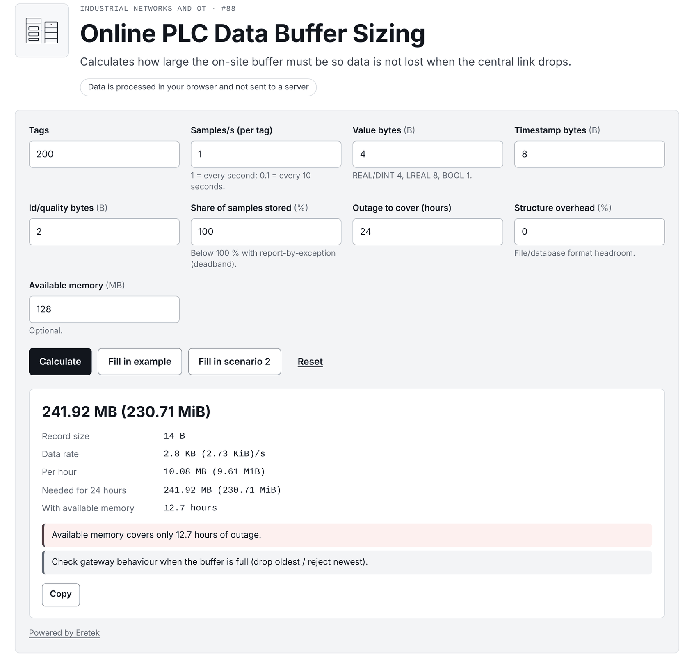

# PLC Data Buffer Sizing

Calculate the memory a store-and-forward buffer needs from tag count, sample rate, record size and outage duration, and how many hours of outage existing memory covers.

## Try it live

- [Türkçe](https://endustriyel.eretek.com/araclar/plc-veri-tamponu)
- [English](https://endustriyel.eretek.com/en/tools/plc-data-buffer-sizing)
- [Deutsch](https://endustriyel.eretek.com/de/werkzeuge/sps-datenpuffer)



## What it does

Calculates how large the on-site buffer must be so data is not lost when the central link drops.

An edge gateway or PLC buffers measurements locally when the historian/cloud link drops (store and forward). When the buffer is full the oldest data is deleted and production records get gaps. The tool gives hourly data volume from tag count and sample rate, the memory needed for a target outage and how long existing memory lasts.

## Where it helps

Size the buffer for the longest expected outage (weekend, maintenance) and set a buffer fill alarm. Use the Historian Storage Calculator for the historian side.

## How to use it

1. Enter tag count and samples per second per tag (1 = every second, 0.1 = every 10 seconds).
2. Enter record size (value, timestamp, id/quality bytes) and the share of samples stored.
3. Enter the outage duration to cover and, if known, available memory; press Run.

### Fields

| Field | Description |
|---|---|
| Tags |  |
| Samples/s (per tag) | 1 = every second; 0.1 = every 10 seconds. |
| Value bytes | REAL/DINT 4, LREAL 8, BOOL 1. |
| Timestamp bytes |  |
| Id/quality bytes |  |
| Share of samples stored | Below 100 % with report-by-exception (deadband). |
| Outage to cover (hours) |  |
| Structure overhead | File/database format headroom. |
| Available memory | Optional. |

## Example input

Press **Fill in example** in the tool to load this input.

| Input | Value |
|---|---|
| Tags | `200` |
| Samples/s (per tag) | `1` |
| Value bytes | `4` |
| Timestamp bytes | `8` |
| Id/quality bytes | `2` |
| Share of samples stored | `100` |
| Outage to cover (hours) | `24` |
| Available memory | `128` |

**Expected result:** 200 tags, 1 sample per second, 14-byte record: 2.8 kB/s, 241.92 MB for 24 hours; 128 MB lasts about 12.7 hours of outage.

## Method and assumptions

Record = value + timestamp + id/quality bytes. Bytes/s = tags × samples/s × stored share × record × (1 + overhead). Needed = bytes/s × hours × 3600. Duration with memory = memory / bytes/s / 3600.

## Limits and common mistakes

- Compression, batching and the gateway software's internal structures are not modelled; prefer vendor memory figures.

## Run it locally

The tool is plain HTML, CSS and JavaScript with no build step and no dependencies.

```bash
git clone https://github.com/eretek/plc-data-buffer-sizing.git
cd plc-data-buffer-sizing
node scripts/serve.js        # or: python3 -m http.server 8080
```

Open <http://127.0.0.1:8080/>. Add `?lang=tr` or `?lang=de` for Turkish or German; without it the page follows the browser language and falls back to English. You can also open `index.html` directly from disk.

Run the tests (Node.js 18 or later):

```bash
node test/run.js    # or: npm test
```

The tests run the tool's own fixtures and the worked examples in all three languages without a browser.

## How it works

All processing happens in your browser. The tool makes no network requests, uses no cookies or browser storage, and does not upload files you select.

No server-side component is needed. The version on the Eretek website renders the same page through a private WordPress plugin; that plugin only produces the page markup and is not part of this repository.

| Path | Purpose |
|---|---|
| `index.html` | Page shell |
| `src/app.js` | Builds the page in Turkish, English or German from `src/data.js` |
| `src/data.js` | Field definitions, examples and all texts in three languages |
| `src/core.js` | Shared runtime: validation, number formats, result rendering, CSV/ICS export |
| `src/tool.js` | The calculation or analysis for this tool |
| `docs/screenshot.png` | Screenshot used in this README |
| `src/tools.css`, `src/page.css` | Styles |
| `test/run.js`, `test/cases.json` | Headless tests |

## License and attribution

This tool is released under the [Eretek Website Attribution License](LICENSE). You may use, modify and redistribute it, including commercially. If you make it available on a website or web application, show a visible, clickable credit linking to https://eretek.com/ on every page where the tool is available, for example:

```html
<a href="https://eretek.com/">Powered by Eretek</a>
```

You may add `rel="nofollow"` to the link. Keep the copyright notice and license text in copies and redistributions.
